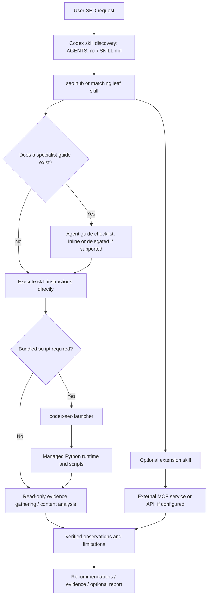

# End-to-end SEO skill and agent map

Generated by `python3 scripts/generate_skill_map.py`. Source-derived references and exact paths; **a mentioned script is not proof that it executes successfully**. Optional API credentials, MCP integrations and Python/Chromium setup are separate.

## System execution path

## Coverage and meanings

- **522** repository files catalogued in [`docs/FILE_INVENTORY.md`](../docs/FILE_INVENTORY.md) and machine-readable [`docs/skill-agent-map.json`](../docs/skill-agent-map.json).
- **30** core skill manifests; **19** specialist agent guides; **0** guide-only specialties.
- **9** optional extension bundles, **7** unique additional skill names that can be registered.
- **62** Python scripts and **73** Python test/fixture sources; **802** explicit graph relationships.
- **Launcher-dispatches-to** and **runtime-allowlisted-script** represent source-verified CLI plumbing; they do not assert dependencies are installed. **Static-python-import** means an actual import of a local Python module. **Owns-support-file** means packaged under that skill folder. **Mentions-script** means a literal script filename appears in instructions (not a verified invocation). **Test-source-mentions-script** does not establish test coverage.
- Claude agent guides are reference checklists unless the running Codex harness supports delegation; agent-only guides do not represent installable skills.

## Core skill → guide → script references → packaged resources

| Codex skill | Agent guide | Script names mentioned in skill/guide | Support files |
|---|---|---|---:|
| [`skills/get-started/SKILL.md`](../skills/get-started/SKILL.md) | — (skill-only) | — (content/API/tool-based) | 1 |
| [`skills/seo/SKILL.md`](../skills/seo/SKILL.md) | — (skill-only) | `backlinks_auth.py`, `drift_history.py`, `google_auth.py`, `google_report.py`, `install_codex.py`, `matomo_auth.py`, `seo_updates.py` | 39 |
| [`skills/seo-agentic/SKILL.md`](../skills/seo-agentic/SKILL.md) | [`agents/seo-agentic.md`](../agents/seo-agentic.md) | `agent_ux_check.py`, `agentic_check.py`, `agentic_fix.py`, `lighthouse_agentic.py`, `render_page.py`, `ucp_check.py` | 8 |
| [`skills/seo-audit/SKILL.md`](../skills/seo-audit/SKILL.md) | — (skill-only) | `backlinks_auth.py`, `drift_history.py`, `google_auth.py`, `google_report.py`, `matomo_auth.py`, `render_page.py`, `seo_updates.py` | 2 |
| [`skills/seo-backlinks/SKILL.md`](../skills/seo-backlinks/SKILL.md) | [`agents/seo-backlinks.md`](../agents/seo-backlinks.md) | `backlinks_auth.py`, `bing_webmaster.py`, `commoncrawl_graph.py`, `keywordseverywhere_api.py`, `moz_api.py`, `render_page.py`, `url_safety.py`, `validate_backlink_report.py`, `verify_backlinks.py` | 2 |
| [`skills/seo-cluster/SKILL.md`](../skills/seo-cluster/SKILL.md) | [`agents/seo-cluster.md`](../agents/seo-cluster.md) | `dataforseo_costs.py`, `render_page.py` | 5 |
| [`skills/seo-competitor-pages/SKILL.md`](../skills/seo-competitor-pages/SKILL.md) | — (skill-only) | — (content/API/tool-based) | 2 |
| [`skills/seo-content/SKILL.md`](../skills/seo-content/SKILL.md) | [`agents/seo-content.md`](../agents/seo-content.md) | `content_humanize.py`, `metadata_template.py`, `render_page.py`, `seo_updates.py`, `url_safety.py` | 2 |
| [`skills/seo-content-brief/SKILL.md`](../skills/seo-content-brief/SKILL.md) | — (skill-only) | — (content/API/tool-based) | 5 |
| [`skills/seo-dataforseo/SKILL.md`](../skills/seo-dataforseo/SKILL.md) | [`agents/seo-dataforseo.md`](../agents/seo-dataforseo.md) | `dataforseo_costs.py` | 4 |
| [`skills/seo-drift/SKILL.md`](../skills/seo-drift/SKILL.md) | [`agents/seo-drift.md`](../agents/seo-drift.md) | `drift_baseline.py`, `drift_compare.py`, `drift_history.py`, `drift_report.py`, `fetch_page.py`, `pagespeed_check.py`, `parse_html.py` | 2 |
| [`skills/seo-ecommerce/SKILL.md`](../skills/seo-ecommerce/SKILL.md) | [`agents/seo-ecommerce.md`](../agents/seo-ecommerce.md) | `dataforseo_costs.py`, `dataforseo_merchant.py`, `dataforseo_normalize.py`, `parse_html.py`, `render_page.py`, `ucp_check.py`, `url_safety.py` | 3 |
| [`skills/seo-flow/SKILL.md`](../skills/seo-flow/SKILL.md) | [`agents/seo-flow.md`](../agents/seo-flow.md) | `sync_flow.py` | 46 |
| [`skills/seo-geo/SKILL.md`](../skills/seo-geo/SKILL.md) | [`agents/seo-geo.md`](../agents/seo-geo.md) | `render_page.py`, `seo_updates.py`, `url_safety.py` | 4 |
| [`skills/seo-google/SKILL.md`](../skills/seo-google/SKILL.md) | [`agents/seo-google.md`](../agents/seo-google.md) | `crux_history.py`, `ga4_report.py`, `google_auth.py`, `google_report.py`, `gsc_inspect.py`, `gsc_query.py`, `indexing_notify.py`, `keyword_planner.py`, `nlp_analyze.py`, `pagespeed_check.py`, `youtube_search.py` | 16 |
| [`skills/seo-handoff/SKILL.md`](../skills/seo-handoff/SKILL.md) | — (skill-only) | — (content/API/tool-based) | 1 |
| [`skills/seo-hreflang/SKILL.md`](../skills/seo-hreflang/SKILL.md) | — (skill-only) | — (content/API/tool-based) | 6 |
| [`skills/seo-image-gen/SKILL.md`](../skills/seo-image-gen/SKILL.md) | [`agents/seo-image-gen.md`](../agents/seo-image-gen.md) | — (content/API/tool-based) | 11 |
| [`skills/seo-images/SKILL.md`](../skills/seo-images/SKILL.md) | — (skill-only) | `iptc_ai_label.py`, `parse_html.py` | 2 |
| [`skills/seo-local/SKILL.md`](../skills/seo-local/SKILL.md) | [`agents/seo-local.md`](../agents/seo-local.md) | `render_page.py`, `url_safety.py` | 2 |
| [`skills/seo-maps/SKILL.md`](../skills/seo-maps/SKILL.md) | [`agents/seo-maps.md`](../agents/seo-maps.md) | — (content/API/tool-based) | 2 |
| [`skills/seo-page/SKILL.md`](../skills/seo-page/SKILL.md) | — (skill-only) | `metadata_template.py` | 2 |
| [`skills/seo-performance/SKILL.md`](../skills/seo-performance/SKILL.md) | [`agents/seo-performance.md`](../agents/seo-performance.md) | `crux_history.py`, `pagespeed_check.py`, `render_page.py` | 1 |
| [`skills/seo-plan/SKILL.md`](../skills/seo-plan/SKILL.md) | — (skill-only) | — (content/API/tool-based) | 8 |
| [`skills/seo-programmatic/SKILL.md`](../skills/seo-programmatic/SKILL.md) | — (skill-only) | `metadata_template.py` | 2 |
| [`skills/seo-schema/SKILL.md`](../skills/seo-schema/SKILL.md) | [`agents/seo-schema.md`](../agents/seo-schema.md) | `parse_html.py`, `render_page.py`, `url_safety.py` | 3 |
| [`skills/seo-sitemap/SKILL.md`](../skills/seo-sitemap/SKILL.md) | [`agents/seo-sitemap.md`](../agents/seo-sitemap.md) | `sitemap_discovery.py` | 2 |
| [`skills/seo-sxo/SKILL.md`](../skills/seo-sxo/SKILL.md) | [`agents/seo-sxo.md`](../agents/seo-sxo.md) | `parse_html.py`, `render_page.py`, `url_safety.py` | 5 |
| [`skills/seo-technical/SKILL.md`](../skills/seo-technical/SKILL.md) | [`agents/seo-technical.md`](../agents/seo-technical.md) | `agent_ux_check.py`, `agentic_check.py`, `crux_history.py`, `fetch_page.py`, `gsc_inspect.py`, `pagespeed_check.py`, `render_page.py`, `sitemap_discovery.py`, `url_safety.py` | 3 |
| [`skills/seo-visual/SKILL.md`](../skills/seo-visual/SKILL.md) | [`agents/seo-visual.md`](../agents/seo-visual.md) | `capture_screenshot.py`, `render_page.py` | 1 |

## Agent-only guides (not separate `$...` skills)

## Optional extensions

| Bundle | Skill manifest | Registration | Packaged files |
|---|---|---|---:|
| `ahrefs` | [`extensions/ahrefs/skills/seo-ahrefs/SKILL.md`](../extensions/ahrefs/skills/seo-ahrefs/SKILL.md) | Opt-in via `--with-extensions` | 6 |
| `banana` | [`extensions/banana/skills/seo-image-gen/SKILL.md`](../extensions/banana/skills/seo-image-gen/SKILL.md) | Duplicate of core skill; do not register twice | 24 |
| `bing-webmaster` | [`extensions/bing-webmaster/skills/seo-bing/SKILL.md`](../extensions/bing-webmaster/skills/seo-bing/SKILL.md) | Opt-in via `--with-extensions` | 6 |
| `dataforseo` | [`extensions/dataforseo/skills/seo-dataforseo/SKILL.md`](../extensions/dataforseo/skills/seo-dataforseo/SKILL.md) | Duplicate of core skill; do not register twice | 13 |
| `firecrawl` | [`extensions/firecrawl/skills/seo-firecrawl/SKILL.md`](../extensions/firecrawl/skills/seo-firecrawl/SKILL.md) | Opt-in via `--with-extensions` | 9 |
| `matomo` | [`extensions/matomo/skills/seo-matomo/SKILL.md`](../extensions/matomo/skills/seo-matomo/SKILL.md) | Opt-in via `--with-extensions` | 7 |
| `profound` | [`extensions/profound/skills/seo-profound/SKILL.md`](../extensions/profound/skills/seo-profound/SKILL.md) | Opt-in via `--with-extensions` | 6 |
| `seranking` | [`extensions/seranking/skills/seo-seranking/SKILL.md`](../extensions/seranking/skills/seo-seranking/SKILL.md) | Opt-in via `--with-extensions` | 6 |
| `unlighthouse` | [`extensions/unlighthouse/skills/seo-unlighthouse/SKILL.md`](../extensions/unlighthouse/skills/seo-unlighthouse/SKILL.md) | Opt-in via `--with-extensions` | 6 |

## Script → referencing skills/guides → tests that mention it

Each test association below is a textual match in test source, **not an assertion of full functional coverage**.

| Runtime file | Referenced by | Tests containing filename/import reference |
|---|---|---|
| [`scripts/agent_ux_check.py`](../scripts/agent_ux_check.py) | `seo-agentic`, `seo-agentic`, `seo-technical` | `test_agentic.py`, `test_phase_j_executable.py` |
| [`scripts/agentic_check.py`](../scripts/agentic_check.py) | `seo-agentic`, `seo-agentic`, `seo-technical` | `test_agentic.py`, `test_hostile_inputs.py` |
| [`scripts/agentic_fix.py`](../scripts/agentic_fix.py) | `seo-agentic` | `test_agentic.py`, `test_hostile_inputs.py` |
| [`scripts/analyze_visual.py`](../scripts/analyze_visual.py) | — (utility/internal/unreferenced) | — |
| [`scripts/backlinks_auth.py`](../scripts/backlinks_auth.py) | `seo-backlinks`, `seo-audit`, `seo-backlinks`, `seo` | `test_backlinks_auth_hardening.py`, `test_dataforseo_tool_names.py`, `test_moz_api.py` |
| [`scripts/bing_webmaster.py`](../scripts/bing_webmaster.py) | `seo-backlinks`, `seo-backlinks` | `test_bing_webmaster.py` |
| [`scripts/capture_screenshot.py`](../scripts/capture_screenshot.py) | `seo-visual` | `test_audit_instructions.py` |
| [`scripts/commoncrawl_graph.py`](../scripts/commoncrawl_graph.py) | `seo-backlinks`, `seo-backlinks` | `test_commoncrawl_graph.py` |
| [`scripts/consistency_check.py`](../scripts/consistency_check.py) | — (utility/internal/unreferenced) | `test_consistency_check.py` |
| [`scripts/content_humanize.py`](../scripts/content_humanize.py) | `seo-content` | `test_content_humanize.py`, `test_content_quality.py` |
| [`scripts/content_quality.py`](../scripts/content_quality.py) | — (utility/internal/unreferenced) | `test_content_quality.py` |
| [`scripts/content_verify.py`](../scripts/content_verify.py) | — (utility/internal/unreferenced) | `test_content_quality.py` |
| [`scripts/crux_history.py`](../scripts/crux_history.py) | `seo-google`, `seo-performance`, `seo-google`, `seo-technical` | `test_google_api_key_safety.py` |
| [`scripts/dataforseo_costs.py`](../scripts/dataforseo_costs.py) | `seo-ecommerce`, `seo-cluster`, `seo-dataforseo`, `seo-ecommerce` | `test_banana_cost_tracker.py`, `test_dataforseo_costs.py` |
| [`scripts/dataforseo_merchant.py`](../scripts/dataforseo_merchant.py) | `seo-ecommerce`, `seo-ecommerce` | — |
| [`scripts/dataforseo_normalize.py`](../scripts/dataforseo_normalize.py) | `seo-ecommerce` | — |
| [`scripts/domain_history.py`](../scripts/domain_history.py) | — (utility/internal/unreferenced) | `test_content_quality.py`, `test_domain_history.py` |
| [`scripts/drift_baseline.py`](../scripts/drift_baseline.py) | `seo-drift`, `seo-drift` | `test_drift_portability.py` |
| [`scripts/drift_compare.py`](../scripts/drift_compare.py) | `seo-drift`, `seo-drift` | — |
| [`scripts/drift_history.py`](../scripts/drift_history.py) | `seo-drift`, `seo-audit`, `seo-drift`, `seo` | — |
| [`scripts/drift_report.py`](../scripts/drift_report.py) | `seo-drift`, `seo-drift` | — |
| [`scripts/fetch_page.py`](../scripts/fetch_page.py) | `seo-drift`, `seo-drift`, `seo-technical` | `test_agent_untrusted_content.py`, `test_audit_instructions.py`, `test_drift_portability.py`, `test_fetch_page_cli.py`, `test_fetch_page_decoding.py`, `test_url_safety.py` |
| [`scripts/ga4_report.py`](../scripts/ga4_report.py) | `seo-google`, `seo-google` | — |
| [`scripts/gbp_deprecation_lint.py`](../scripts/gbp_deprecation_lint.py) | — (utility/internal/unreferenced) | `test_fetch_page_decoding.py`, `test_gbp_lint_and_polish.py` |
| [`scripts/generate_skill_map.py`](../scripts/generate_skill_map.py) | — (utility/internal/unreferenced) | `test_skill_map.py` |
| [`scripts/google_auth.py`](../scripts/google_auth.py) | `seo-google`, `seo-audit`, `seo-google`, `seo` | `test_backlinks_auth_hardening.py`, `test_google_api_key_safety.py`, `test_google_gcloud_adc.py`, `test_url_safety.py` |
| [`scripts/google_report.py`](../scripts/google_report.py) | `seo-google`, `seo-audit`, `seo-google`, `seo` | `test_google_report_full_audit.py` |
| [`scripts/gsc_inspect.py`](../scripts/gsc_inspect.py) | `seo-google`, `seo-google`, `seo-technical` | — |
| [`scripts/gsc_query.py`](../scripts/gsc_query.py) | `seo-google`, `seo-google` | `test_gsc_pagination.py`, `test_gsc_query.py`, `test_gsc_totals_aggregate.py` |
| [`scripts/indexing_notify.py`](../scripts/indexing_notify.py) | `seo-google` | — |
| [`scripts/indexnow_submit.py`](../scripts/indexnow_submit.py) | — (utility/internal/unreferenced) | `test_technical_depth.py` |
| [`scripts/install_codex.py`](../scripts/install_codex.py) | `seo` | `test_codex_installer.py` |
| [`scripts/iptc_ai_label.py`](../scripts/iptc_ai_label.py) | `seo-images` | `test_phase_j_executable.py` |
| [`scripts/keyword_planner.py`](../scripts/keyword_planner.py) | `seo-google` | — |
| [`scripts/keywordseverywhere_api.py`](../scripts/keywordseverywhere_api.py) | `seo-backlinks` | `test_hostile_inputs.py`, `test_keywordseverywhere_api.py`, `test_runtime.py` |
| [`scripts/lcp_subparts.py`](../scripts/lcp_subparts.py) | — (utility/internal/unreferenced) | `test_google_api_key_safety.py`, `test_technical_depth.py` |
| [`scripts/lighthouse_agentic.py`](../scripts/lighthouse_agentic.py) | `seo-agentic`, `seo-agentic` | `test_agentic.py`, `test_hostile_inputs.py` |
| [`scripts/matomo_auth.py`](../scripts/matomo_auth.py) | `seo-audit`, `seo` | `test_matomo_report.py` |
| [`scripts/matomo_report.py`](../scripts/matomo_report.py) | — (utility/internal/unreferenced) | `test_matomo_report.py` |
| [`scripts/metadata_template.py`](../scripts/metadata_template.py) | `seo-content`, `seo-page`, `seo-programmatic` | `test_codex_runtime_contract.py`, `test_metadata_template.py`, `test_no_em_dash.py` |
| [`scripts/moz_api.py`](../scripts/moz_api.py) | `seo-backlinks`, `seo-backlinks` | `test_moz_api.py` |
| [`scripts/nlp_analyze.py`](../scripts/nlp_analyze.py) | `seo-google` | `test_fetch_page_decoding.py`, `test_google_api_key_safety.py`, `test_nlp_analyze.py` |
| [`scripts/pagespeed_check.py`](../scripts/pagespeed_check.py) | `seo-google`, `seo-performance`, `seo-drift`, `seo-google`, `seo-performance`, `seo-technical` | `test_google_api_key_safety.py`, `test_pagespeed_null_category_score.py` |
| [`scripts/parasite_risk.py`](../scripts/parasite_risk.py) | — (utility/internal/unreferenced) | `test_fetch_page_decoding.py`, `test_parasite_risk_and_extensions.py` |
| [`scripts/parse_html.py`](../scripts/parse_html.py) | `seo-ecommerce`, `seo-sxo`, `seo-drift`, `seo-ecommerce`, `seo-images`, `seo-schema`, `seo-sxo` | `test_agent_untrusted_content.py`, `test_drift_portability.py`, `test_fetch_page_decoding.py`, `test_lazy_detection.py`, `test_parse_html_rel_case.py` |
| [`scripts/portability_check.py`](../scripts/portability_check.py) | — (utility/internal/unreferenced) | `test_portability.py` |
| [`scripts/preload_check.py`](../scripts/preload_check.py) | — (utility/internal/unreferenced) | `test_fetch_page_decoding.py`, `test_technical_depth.py` |
| [`scripts/release_sign.py`](../scripts/release_sign.py) | — (utility/internal/unreferenced) | — |
| [`scripts/render_page.py`](../scripts/render_page.py) | `seo-agentic`, `seo-backlinks`, `seo-content`, `seo-ecommerce`, `seo-geo`, `seo-local`, `seo-performance`, `seo-schema`, `seo-sxo`, `seo-technical`, `seo-visual`, `seo-audit`, `seo-cluster`, `seo-ecommerce`, `seo-sxo`, `seo-technical` | `test_agent_untrusted_content.py`, `test_agentic.py`, `test_audit_instructions.py`, `test_fetch_page_cli.py`, `test_fetch_page_decoding.py`, `test_phase_j_executable.py`, `test_render_page.py`, `test_runtime.py` |
| [`scripts/runtime.py`](../scripts/runtime.py) | — (utility/internal/unreferenced) | `test_agentic.py`, `test_codex_runtime_contract.py`, `test_hosted_plugin_layout.py`, `test_manual_install_layout.py`, `test_runtime.py`, `test_runtime_installers.py`, `test_schema_hook_detection.py` |
| [`scripts/schema_ecommerce_validate.py`](../scripts/schema_ecommerce_validate.py) | — (utility/internal/unreferenced) | `test_schema_v2.py` |
| [`scripts/schema_generate.py`](../scripts/schema_generate.py) | — (utility/internal/unreferenced) | `test_codex_runtime_contract.py`, `test_schema_v2.py` |
| [`scripts/seo_updates.py`](../scripts/seo_updates.py) | `seo-audit`, `seo-content`, `seo-geo`, `seo` | `test_content_quality.py`, `test_manual_install_layout.py` |
| [`scripts/sitemap_discovery.py`](../scripts/sitemap_discovery.py) | `seo-sitemap`, `seo-technical`, `seo-sitemap`, `seo-technical` | `test_sitemap_discovery.py` |
| [`scripts/sync_flow.py`](../scripts/sync_flow.py) | `seo-flow` | `test_no_em_dash.py`, `test_sync_flow.py` |
| [`scripts/ucp_check.py`](../scripts/ucp_check.py) | `seo-agentic`, `seo-ecommerce` | `test_fetch_page_decoding.py`, `test_hostile_inputs.py`, `test_phase_j_executable.py` |
| [`scripts/unlighthouse_run.py`](../scripts/unlighthouse_run.py) | — (utility/internal/unreferenced) | `test_technical_depth.py`, `test_unlighthouse_run.py` |
| [`scripts/url_safety.py`](../scripts/url_safety.py) | `seo-backlinks`, `seo-content`, `seo-ecommerce`, `seo-geo`, `seo-local`, `seo-schema`, `seo-sxo`, `seo-technical` | `test_agentic.py`, `test_backlinks_auth_hardening.py`, `test_domain_history.py`, `test_fetch_page_decoding.py`, `test_keywordseverywhere_api.py`, `test_lazy_detection.py`, `test_matomo_report.py`, `test_render_page.py`, `test_technical_depth.py`, `test_url_safety.py` |
| [`scripts/validate_backlink_report.py`](../scripts/validate_backlink_report.py) | `seo-backlinks`, `seo-backlinks` | `test_backlink_score_gate.py`, `test_validate_backlink_report.py` |
| [`scripts/verify_backlinks.py`](../scripts/verify_backlinks.py) | `seo-backlinks`, `seo-backlinks` | — |
| [`scripts/verify_release.py`](../scripts/verify_release.py) | — (utility/internal/unreferenced) | — |
| [`scripts/youtube_search.py`](../scripts/youtube_search.py) | `seo-google` | — |

## How to audit / update this map

1. Run `python3 scripts/generate_skill_map.py` after adding, moving or removing repository files.
2. Run `python3 scripts/generate_skill_map.py --check`, `python3 scripts/portability_check.py --strict` and `python3 -m unittest discover -s tests -p test_codex_installer.py`.
3. Read `docs/FILE_INVENTORY.md` for **each file**, its kind and owning domain; read `docs/skill-agent-map.json` for directed relationships.
4. Do not interpret a Markdown mention, extension catalog entry or agent checklist as runtime capability or verified live SEO data.
